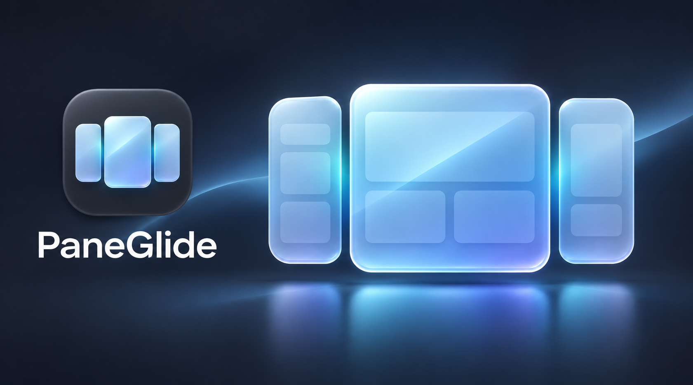

# PaneGlide



Arrange your Mac's windows with keyboard shortcuts or a menu bar click. PaneGlide
supports halves, quarters, custom centered windows, monitor transfers, and narrow
side panes for ultrawide displays. Each display can have its own layout.

**macOS 14+ · Apple silicon · Free and open source · GPL v3**

[Install](#install) · [Shortcuts](#move-windows) · [Configure](#configure-paneglide) ·
[AppleScript](#automate-with-applescript) · [Help](#troubleshooting) ·
[Releases](https://github.com/jpwinans/paneglide/releases) · [Contribute](CONTRIBUTING.md)

## Install

PaneGlide builds on your Mac using **Apple's free developer tools (Swift 6+)**.
No paid developer account or Apple distribution certificate is needed. Setup uses
Terminal; everyday use is through the menu bar and keyboard.

1. **[Download the source ZIP](https://github.com/jpwinans/paneglide/releases/latest/download/PaneGlide-source.zip)**
   and double-click it to extract it.
2. Open **Terminal**. If Apple's developer tools are not installed, run
   `xcode-select --install` and finish the installation dialog. Current Command Line
   Tools or Xcode 16+ work; the installer checks your tools for you.
3. Type `cd ` (with the space), drag the extracted folder into Terminal, press
   Return, then run:

   ```sh
   bash install.sh
   ```

4. PaneGlide opens **Quick Start**. Follow its Accessibility instructions and choose
   whether to start automatically at login. Then focus another app's window and try
   **Control–Option–Command–Left**. Use **Control–Option–Command–/** to restore it.

The installer builds, installs in your home folder's **Applications**, and opens
PaneGlide. It needs no administrator access. PaneGlide stays in the menu bar;
quit other window managers or disable their matching shortcuts first.

**To update:** download the newer source ZIP and run `bash install.sh` again. Your
saved settings stay in place, and the installer keeps a backup of the previous app.
A rebuild may require removing and re-adding PaneGlide's Accessibility entry.
See [installation help](docs/installation.md) for tool setup, updates, restoring a
backup, and removal. The app has no built-in updater; **View on GitHub…** opens the
repository. **Help…** works offline, and **Edit Shortcuts…** opens the shortcut editor.

## Move windows

First focus the window you want to arrange, then press a shortcut or choose an action
from the menu bar icon. Only that window moves. Successful actions are silent.

**⌃ Control · ⌥ Option · ⌘ Command · ⇧ Shift**

| Action | Default shortcut | Result |
| --- | --- | --- |
| Left / Right | ⌃⌥⌘← / ⌃⌥⌘→ | Use the left or right split; repeat for an enabled alternate width |
| Up / Down | ⌃⌥⌘↑ / ⌃⌥⌘↓ | Use the upper or lower split |
| Upper Left / Upper Right | ⌃⌥⇧← / ⌃⌥⇧↑ | Use the corresponding upper quarter |
| Lower Left / Lower Right | ⌃⌥⇧↓ / ⌃⌥⇧→ | Use the corresponding lower quarter |
| Maximize | ⌃⌥⌘M | Fill the usable desktop without entering a macOS full-screen Space |
| Center | ⌃⌥⌘C | Center the window, optionally resizing to your configured dimensions |
| Previous Monitor / Next Monitor | ⌃⌥← / ⌃⌥→ | Move the window to another display |
| SnapBack | ⌃⌥⌘/ | Restore the window's position and size before your sequence of actions |

Release and press a shortcut again to repeat it. Holding a key performs one action.

### Move between monitors

Previous/Next Monitor follows macOS display order and wraps at either end. Transfers
preserve relative placement and, by default, scale the window to the destination's
usable area. In **Advanced**, turn off **Resize windows proportionally when changing
monitors** to retain its size where it fits. With one display, monitor actions leave
the window where it is. Layout actions use the destination display's settings.

### Restore with SnapBack

Each window remembers its own starting position and size before the first successful
change. You can move Left, use an alternate width, change monitors, and then use
SnapBack to return to that starting frame. A successful restore clears the saved
baseline; the next change starts a new sequence. If the original monitor is missing,
PaneGlide restores on the current display where possible. Quitting clears this history.

## Configure PaneGlide

Open **Preferences…** from the menu. Most edits are a draft: choose **Apply**
(**Command–Return**) to save, or **Revert Unsaved Changes** to discard edits.
Closing Preferences discards unsaved changes. The login switch takes effect immediately.

### General: startup and menu visibility

- Enable **Start PaneGlide automatically at login** to start with your Mac. Check the
  status beneath it; if approval is needed, use **Open Login Items Settings…**.
- Enable **Show preferences on launch** if you want the settings window at startup.
- **Show PaneGlide in menu bar** controls the icon. If you hide it, reopen PaneGlide
  from Finder to reach Preferences again.
- **Quick Start…** opens setup guidance for Accessibility, shortcuts, and startup. No Screen Recording
  permission is needed. See [Privacy](docs/privacy.md) for how window data is handled.

### Shortcuts: change keys and menu items

Click an action's shortcut, then press the new combination. Include Control, Option,
or Command. **Escape** cancels recording; **Delete** clears the binding. Choose Apply.
Duplicate or unavailable shortcuts produce an explanation and retain the saved bindings.

**Restore Default Shortcuts** resets bindings in the draft. **Show in menu** hides or
shows individual actions without changing their shortcuts. Turn off **Enable shortcuts**
or choose **Disable Shortcuts** in the menu to pause global keys; menu and AppleScript
actions still work.

### Display profiles: different layouts for each screen

Margins, Partitions, and Window Sizes share a **Display settings** picker.

1. Choose **Global defaults** for layouts used by displays without an override.
2. To customize a monitor, select it and enable **Use separate settings for this display**.
   Its profile starts as a copy of the global defaults.
3. Edit its margins, dividers, or sizes and choose Apply.

Existing profiles keep their own values when global defaults change. Turn separate
settings off and Apply to use global defaults again. Disconnected displays keep
their profiles. Shortcuts, General, and Advanced settings apply across displays.

### Margins: leave space around and between windows

In **Margins**, enable **edge margins** and set Top, Left, Bottom, and Right distances.
Enable **partition gaps** to set Horizontal and Vertical space between adjoining windows.
The two switches are independent and keep their entered values when disabled.

Layouts use the desktop area available around the Dock and menu bar, reduced by
edge margins. Percentages refer to that remaining area. Fixed dimensions use
**logical macOS points**, rather than physical pixels, so they work across Retina
scaling. Gaps are shared across adjoining edges rather than added to screen edges.

### Partitions: choose your split proportions

In **Partitions**, change **Left width** and **Upper height** under **Split screen
partitions** to control Left/Right and Up/Down. The remaining space becomes the
opposite region. **Quarter screen partitions** has independent dividers for the
four corner actions. Divider values must be between 0% and 100%, excluding the endpoints.

**Reset Split** or **Reset Quarters** returns that pair of dividers to 50%/50%.
Choose Apply to save.

### Window Sizes: Center and repeated Left/Right

For **Center**, enable **Resize when centering**, then enter a width and height in
percent or points. Disable it to center the window at its current size. New settings
start at 50% width and 100% height; both values are configurable.

To add a second width to Left or Right:

1. Enable **Alternate Left**, **Alternate Right**, or both.
2. Enter each side's width in percent or points. Enable **Use the left alternate
   width for both sides** if you want matching sides; each side still has its own
   enable switch.
3. Alternatively, enable **Fit beside Center** to calculate the side width from
   Center's configured width and the horizontal gap. Center resizing must be enabled
   and leave enough room for the sides.
4. Review the preview and choose Apply.

Left/Right uses the normal split unless the window already matches it, in which case
it uses the alternate width. Another press returns to the normal split. There is no
double-press timer. Alternate panes remain full height and anchored to their screen
edge. Moving or resizing a window away from the normal region makes the next action
use the normal split again.

**Fit beside Center follows your settings; it does not inspect or move another window.**
Positive sizes are required, and percentages cannot exceed 100%. Fixed sizes larger
than the available area are capped when applied; individual apps can impose minimum sizes.

### Set up an ultrawide workspace

1. Select your ultrawide display in Window Sizes and enable its separate settings.
2. Set Center to your preferred width and height. Enable both alternate sides and
   choose manual widths or Fit beside Center. Apply.
3. Focus your main window and press **⌃⌥⌘C**.
4. Focus the left-side app and press **⌃⌥⌘←**, then press again for its alternate width.
5. Focus the right-side app and do the same with **⌃⌥⌘→**.

For example, 20% / 60% / 20% fills the width with zero margins and gaps. These are
only example values: the center and both sides are configurable, including fixed
point widths. Keep alternate widths disabled on your laptop if you prefer ordinary
halves there. Reapply actions after editing a layout to reposition existing windows.

### Advanced: handle windows with size limits

| Option | Use it to… |
| --- | --- |
| Resize windows proportionally when changing monitors | Scale a transferred window for the destination display |
| Center windows that do not resize fully | Center a constrained window within the requested region |
| Try to keep windows in bounds | Keep windows within the available display area where possible |

Apps can enforce minimum sizes, fixed dimensions, or resize increments. PaneGlide
uses the closest size the application allows.

### Back up or move your settings

**Export Saved Settings…** saves the applied configuration, including display profiles,
to a JSON file. **Import Saved Settings…** loads a file into the draft; review it and
choose Apply. Unsaved edits are not exported. Invalid imports leave saved settings intact.

Settings live in `~/Library/Application Support/PaneGlide/settings.json`. Exports do
not include Accessibility permission, login registration, or SnapBack history. Configure
those macOS permissions separately on another Mac. See the
[configuration reference](docs/configuration.md) for recovery behavior and full details.

## Automate with AppleScript

AppleScript adds move-only actions, thirds, exact geometry, custom grids, and multi-window
arrangements. Open **Script Editor → File → Open Dictionary → PaneGlide** to browse
commands. To try an example, run this script and switch to your target window during
the delay:

```applescript
delay 3
tell application "PaneGlide"
    do action Third Center
end tell
```

Replace the command inside the block with one of these:

| Task | Command |
| --- | --- |
| Use a menu layout | `do action Left`, `do action Center`, `do action Maximize`, or `do action SnapBack` |
| Move without resizing | `do action Move Left`; also `Move Right`, `Move Up`, `Move Down`, `Move Upper Left`, `Move Upper Right`, `Move Lower Left`, `Move Lower Right`, and `Move Center` |
| Use thirds | `do action Third Center`; also `Third Left`, `Third Right`, `Third Upper`, `Third Middle`, and `Third Lower` |
| Move to a position | `move to {40, 60}` |
| Resize | `resize to {800, 600}` |
| Set position and size | `move and resize to {40, 60, 800, 600}` |
| Fill a custom grid region | `fit to grid {1, 0, 2, 3} grid size {4, 3}` |
| Use a particular display | `do action Center on monitor 2` or `send to monitor 2` |
| Tile or cascade the current app's windows | `tile windows` or `cascade windows` |
| Tile visible windows across apps on a display | `tile windows on monitor 1 all applications true` |
| Pause or resume global shortcuts | `set enabled to false` or `set enabled to true` |
| Open the status menu | `show menu` (when the icon is enabled) |
| Read app information | `get version`, `get name`, or `get frontmost` |

Positions are relative to the chosen display's usable area, in points. Monitor indexes
start at **1**; grid cells start at **0**. The grid example fills two columns across all
three rows of a four-column grid. Without `grid size`, the grid is 6×6.

Tile and Cascade normally use visible, normal windows of the frontmost app on its
current display. `all applications true` explicitly includes other apps' windows on
that display. Batches support up to 64 eligible windows and give each changed window
its own SnapBack baseline. They skip hidden, minimized, native-full-screen, and
ambiguous same-frame windows.

Window commands return actual frames as `{x, y, width, height}` in absolute desktop
coordinates with a top-left origin; batch commands return a list of frames. Invalid
requests or inaccessible windows raise AppleScript errors. macOS may ask for Automation permission for your script host.
The [scripting guide](docs/scripting.md), [layout examples](docs/examples/layouts.applescript),
and [batch examples](docs/examples/batch.applescript) cover every action and parameter.
PaneGlide does not move windows between macOS Spaces or provide drag-to-edge snapping.

## Troubleshooting

| Problem | Try this |
| --- | --- |
| Nothing moves | Check Accessibility status in General; use an ordinary, unminimized window outside native full-screen mode |
| A shortcut is unavailable or does nothing | Enable shortcuts; quit a competing utility or assign a different combination, then Apply |
| Left/Right never uses the alternate | Enable it for the current display, Apply, and release before pressing again; an app's minimum size can prevent the normal region from matching |
| A window will not fit | Use a larger region or adjust Advanced options; some apps restrict resizing |
| A monitor uses unexpected sizes | Check its Display settings profile and the units you selected |
| Edits disappear | Choose Apply before closing Preferences; only the login switch saves immediately |
| The icon is hidden | Reopen PaneGlide from Finder, enable Show PaneGlide in menu bar, and Apply |
| Access stopped working after a rebuild | Quit and reopen the installed copy; if needed, remove and re-add only PaneGlide's Accessibility entry |

If a menu or shortcut command fails, its explanation appears at the top of the menu
and clears after the next successful action. **Quick Start…** shows permission and
startup setup. **Help…** opens the built-in
guide, with an **Edit Shortcuts…** button that opens the shortcut editor directly.
**About PaneGlide…** shows the installed version. **Quit PaneGlide** stops the app.

For more help, see [Support](SUPPORT.md) or
[report a bug](https://github.com/jpwinans/paneglide/issues/new/choose).
Use [private vulnerability reporting](SECURITY.md) for security concerns.

## Contribute and develop

Read [Contributing](CONTRIBUTING.md) for local setup, tests, and pull requests, and
follow the [Code of Conduct](CODE_OF_CONDUCT.md). GitHub Actions is disabled; checks
run locally. The app uses Swift, AppKit, and SwiftUI with no third-party package dependencies.

| Directory | Contents |
| --- | --- |
| `Sources/PaneGlideCore/` | Geometry, window commands, settings, shortcuts, and setup state |
| `Sources/PaneGlideApp/` | Menu bar app, preferences, Accessibility, and macOS services |
| `Resources/` | App icon artwork, bundle metadata, and scripting dictionary |
| `Tools/` | Disposable window fixture |
| `Tests/` | Automated tests and native test instructions |
| `docs/` | Installation, configuration, usage, privacy, and scripting guides |

[Full documentation](docs/README.md) · [Tests](Tests/README.md) ·
[Release packaging](docs/releasing.md) · [Privacy](docs/privacy.md) · [Security](SECURITY.md)

## License

Copyright (c) 2026 jpwinans. PaneGlide is licensed under the
[GNU General Public License, version 3 only](LICENSE) (`GPL-3.0-only`).
